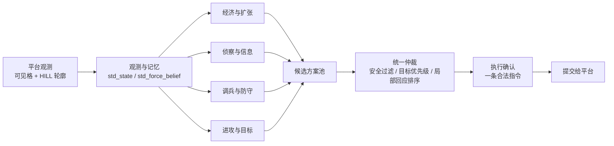

# 您说的队 · Commander-II AI 智能体

> 2026 ISCIIA 人工智能挑战赛 · AI 对战赛道 · **一等奖**
> 北京理工大学 · 您说的队（队长：伍家齐）

[](https://github.com/xii-pm/commander2-ai/actions/workflows/ci.yml)
[](https://www.python.org/)
[](LICENSE)
[](#比赛与成绩)
[](docs/MODULES.md)

一个运行在**北京理工大学 Commander-II 对战平台**上的六边形战棋智能体：在战争迷雾下，
它只用当前可见格和公开的 HILL 轮廓做决策，每一步只提交一条合法指令，靠规则评分、
BFS、动态规划和有限局部搜索完成扩张、侦察、调兵、防守与攻城。

**95 个模块 / 15,379 行 Python / 740 KB / 零第三方依赖**（仅用 Python 3.6 标准库），
`bfs_agent.py` 不 import 任何平台 SDK，因此策略主体可以在没有平台的情况下离线测试。

---

## 目录

- [比赛与成绩](#比赛与成绩)
- [设计要点](#设计要点)
- [决策流水线](#决策流水线)
- [仓库结构](#仓库结构)
- [快速开始（不需要平台）](#快速开始不需要平台)
- [在 Commander-II 平台上部署](#在-commander-ii-平台上部署)
- [配置系统](#配置系统)
- [复现与评测](#复现与评测)
- [局限性与合规声明](#局限性与合规声明)
- [许可与引用](#许可与引用)

## 比赛与成绩

| 项目 | 内容 |
| --- | --- |
| 赛事 | 2026 ISCIIA 人工智能挑战赛（AI 对战赛道） |
| 平台 | 北京理工大学 Commander-II 对战平台 |
| 成绩 | **一等奖** |
| 参赛队 | 您说的队 |
| 队长 | 伍家齐 |
| 席位 | 多人（含三人图与四人图）、战争迷雾、每步一条指令 |
| 实现 | Python 3.6 标准库；规则评分 + BFS + 动态规划 + 有限局部搜索 |
| 原始提交 | `您说得队.zip`，SHA-256 `e9e7818dfb8f5fcdde47ade352048f4323a37c6003eab97933bb1c9715b957dc` |

训练与调参在队伍自建的对抗环境中完成：以上帝 AI（掌握全图信息的固定基准）和多个
自训对手做对照，同图、同出生席位比较版本差异，累计 500 轮迭代后形成参赛版本。
答辩路演材料见 [docs/您说的队-路演PPT.pptx](docs/您说的队-路演PPT.pptx)。

## 设计要点

| 要点 | 做法 | 关键模块 |
| --- | --- | --- |
| **每一步只出一条指令** | 所有候选方案在同一观测下竞争，安全过滤、目标优先级、局部回应排序后只提交一条 | `std_continuous.py`、`std_decisions.py` |
| **迷雾中的 HILL 轮廓探路** | 视野外显示为 HILL 的位置作为"线索"传入；首次可见格 +4 分，未确认的 HILL 轮廓再 +8 分（3 城 12 分 vs 含 1 个线索 20 分），路线仍按已确认地形规划 | `std_continuous.py`、`bfs_agent.py`、`std_opening_policy.py` |
| **动态规划集兵** | 在己方路网树上做 DP，比较「指令成本 → 可送达兵力」，删掉更费指令却不多送兵的方案；集兵预算 24 条指令，且只用当前库存支付，不预支未来产兵 | `std_fort_assembly.py`、`std_merge.py`、`std_maneuver.py` |
| **按到达时间防守** | 把每个对手的行动预算铺到未来 12 步，扣掉现有驻军与产兵得到逐时点缺口，用到达曲线 A(t) 比较方案；最早缺口 ≤4 步时补搜非支配送达方案 | `std_security.py`、`std_deadline_convoy.py`、`std_rescue_utility.py` |
| **特殊地图 314** | 用己方出生点与已见地形识别 314 号图，切换到三人图专用策略；静态地形知识公开、归属与兵力仍只来自观测 | `std_map314.py`、`std_map314_strategy.py` |
| **可被推翻的主城先验** | 四人布局下用行/列反射建立最多 3 个候选区域，先搜半径 3，再按观测逐格排除；矛盾时扩大或停用 | `std_king_prior.py` |
| **隐藏兵力可能位置** | 记录可观测的 ≥64 兵库存损失与附近隐藏位置，最长 64 次观测；同一对手取最大压力，跨对手相加 | `std_force_belief.py` |
| **稳定承诺与回应控制** | 对普通低分候选做评分迟滞，避免短期判断反复打断已筹足兵力的多步任务；用证据身份限制同一模糊线索被反复干预 | `std_response_control.py`、`std_enhancements.py` |

## 决策流水线



四个领域的候选**同时**生成、共同争取兵力和指令额度，而不是按顺序各走一遍；
统一仲裁层负责把"现在该干什么"收敛成一条指令，并在下一帧用真实观测重算。

## 仓库结构

```
.
├── Core.py                    # 平台入口：Load() / Main()，调用 SDK 并把指令下发
├── worker.py                  # 平台无关的 JSONL 适配器：stdin 观测 → stdout 决策
├── bfs_agent.py               # 策略入口 Agent：无 SDK 依赖
├── std_*.py                   # 95 个策略模块（见 docs/MODULES.md）
├── parameters.json            # 参赛版本配置：116 项偏离默认值，其中 100 个开关开启
├── opening_policy_provenance.json  # 开局策略迁移的溯源记录（见 PROVENANCE.md）
├── tests/                     # 25 个单元/集成测试，不需要平台
├── tools/                     # 离线工具：配置校验、JSONL 演示、文档生成
├── docs/                      # 架构、部署、参数、发布指南、路演 PPT
└── .github/workflows/ci.yml   # 三版本 Python 矩阵 + 文档一致性检查
```

## 快速开始（不需要平台）

只需要 Python 3.6+，没有第三方依赖：

```bash
# 1. 校验参赛配置（未知键、类型错误、越界值、冲突开关都会直接报错）
python tools/validate_config.py

# 2. 跑测试：几何不变量、配置契约、策略决策、JSONL 协议端到端
python -m unittest discover -s tests -v

# 3. 亲手喂一个观测，看它输出指令
python tools/demo_worker.py
```

`demo_worker.py` 的输出长这样（决策耗时随机器不同）：

```
handshake   : {'ready': 1}
action index: 502
order       : [1, 3, 11, 4, 11, 29]      # [army, src_r, src_c, dst_r, dst_c, amount]
report      : {'tick': 1, 'mode': 'assault', 'owned': 3, 'units': 40, ...}
```

`tests/` 里覆盖了：

- 六边形几何与平台方向表的自洽性（BFS 最短距离与 `hex_distance` 逐一比对）；
- `move_number()` 的兵量编码语义（`num=0` 是"除一个外全部"，必须用显式数量）；
- 配置校验的严格性（217 个参数、类型、范围、互相依赖的开关）；
- `Agent.decide()` 返回合法指令、确定性、`last_report` 可 JSON 序列化；
- `worker.py` 的 JSONL 握手、决策回复、非法观测拒绝。

## 在 Commander-II 平台上部署

平台运行 `Core.py` 的 `Load()` 与 `Main()`，`Commander` SDK 由平台注入。完整步骤、
JSONL 协议字段、调试开关（`COMMANDER_BFS_TRACE=1`）见 **[docs/DEPLOY.md](docs/DEPLOY.md)**。

要点：

1. 把仓库根目录的 `*.py` 与 `parameters.json` 平铺放进平台的选手 AI 目录
   （与 `Core.py` 同级），不要带 `tests/`、`tools/`、`docs/`；
2. 运行环境是平台内置的 Python 3.6，只允许标准库；
3. 每一步只提交一条指令，超时或非法指令会被判负，因此所有候选方案都必须先过安全过滤。

## 配置系统

- `std_config.DEFAULTS`：217 个开关与阈值的冻结基线；
- `parameters.json`：参赛版本的实际取值（116 项偏离默认，100 个布尔开关开启）；
- `std_config.validate()`：**严格**校验——未知键、类型不符、越界、以及互相冲突的
  组合（例如"修复拦截放宽"缺少"拦截后修复"）都会抛 `ValueError`，不会静默降级。

全部参数、默认值与生产值的对照表由工具自动生成：[docs/PARAMETERS.md](docs/PARAMETERS.md)
（`python tools/gen_docs.py`，CI 会检查它是否过期）。

## 复现与评测

本仓库能复现的是**决策逻辑**，不是平台上的完整对局：

| 可以离线复现 | 需要平台环境 |
| --- | --- |
| 配置合法性与 217 项参数语义 | 真实对局与迷雾状态推进 |
| 六边形几何、方向表、兵量编码 | 地图文件与出生席位 |
| 单步决策与 JSONL 协议 | 上帝 AI 基准、对手池、回放 |
| 25 项测试与文档生成 | 与 500 轮迭代相同的对抗环境 |

队伍内部的对照方法是**同图、同席位**跑新旧版本：只有地图与出生席位固定，胜负差异
才能归因到代码改动，而不是随机地图。

## 局限性与合规声明

- 这是**启发式**策略，不是博弈论意义上的最优解：搜索有界、估值含经验权重，
  在极端局面下会退化为保守方案；
- 部分局部搜索是单次换手模型，不完整模拟后续产兵与迷雾变化；
- 仓库**不包含**平台 SDK、地图、回放、训练输出或其他队伍代码；
- 部分模块由队伍自训对手迁移而来，详见 [PROVENANCE.md](PROVENANCE.md)；
- 代码仅供学习与研究使用。若用于比赛，请先确认当届竞赛规则关于开源、复盘与
  代码来源的要求。

## 许可与引用

代码以 [MIT License](LICENSE) 发布。转载请注明出处：

```bibtex
@misc{youshuode_dui_commander2_2026,
  title  = {您说的队 · Commander-II AI 智能体},
  author = {伍家齐 and 您说的队},
  year   = {2026},
  note   = {2026 ISCIIA 人工智能挑战赛 AI 对战赛道一等奖},
  url    = {https://github.com/xii-pm/commander2-ai}
}
```

---

## Abstract (English)

A fog-of-war hex-grid agent for the Commander-II battle platform (Beijing Institute
of Technology), winner of the **First Prize** at the 2026 ISCIIA AI Challenge. The
agent commits exactly one legal order per observation; economic, scouting, defensive
and offensive candidates are generated simultaneously and arbitrated by safety
filtering, objective priority and bounded local response search. It uses only the
Python 3.6 standard library — rule-based scoring, BFS, dynamic programming and a
bounded local search, with no neural network or online training. 95 modules,
15.4k lines, 25 offline tests, zero third-party dependencies. See
[docs/ARCHITECTURE.md](docs/ARCHITECTURE.md) for the design, [docs/DEPLOY.md](docs/DEPLOY.md)
for platform integration and [PROVENANCE.md](PROVENANCE.md) for code lineage.
