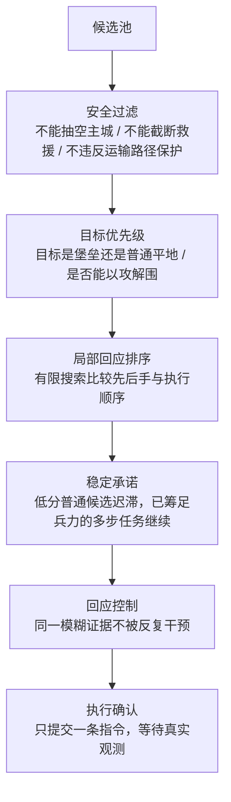

# 架构说明

本文说明这套智能体的信息边界、候选方案如何生成、以及最后怎样收敛成一条指令。
模块级清单见 [MODULES.md](MODULES.md)，参数表见 [PARAMETERS.md](PARAMETERS.md)。

## 1. 信息边界（为什么它能在迷雾下工作）

策略主体 `bfs_agent.Agent` **不 import 平台 SDK**，它只接受两样东西：

1. `cells`：**当前可见**格子的 `(地形, 归属, 兵力)` 三元组，不可见格根本不在字典里；
2. `hill_hints`：视野外显示为 HILL 的坐标集合——这是平台公开给选手的轮廓线索，
   不是真实地形。

隐含契约（也是代码里反复出现的注释主题）：

- 不读取地图真值、出生坐标、对手代码或观战接口；
- 看不到的格子只能通过**历史观测**与**可能性模型**间接推断，且必须可被新观测推翻；
- HILL 轮廓是"待查线索"，路线搜索永远不会把它当成可通行道路；
- 一切兵力支出只允许用**当前库存**支付，未来产兵只能作为攒兵目标。

`Core.py` 负责在平台侧把 SDK 读成上面这两个输入；`worker.py` 负责在没有平台时用
JSONL 协议喂同样的输入。两条路径共用同一个 `Agent`。

## 2. 候选方案池

每个观测下，四个领域**同时**产出候选（而不是依次执行）：

| 领域 | 典型候选 | 主要模块 |
| --- | --- | --- |
| 经济与扩张 | 占低守中立平地、买相邻产能、集兵夺首堡、攒兵、补产兵点 | `std_investment.py`、`std_fort_assembly.py`、`std_neutral_funding.py`、`std_nearby_capital.py`、`std_single_capital_fortress.py` |
| 侦察与信息 | 前沿探索、HILL 轮廓探路、搜索纵队、首堡盲区探查、主城先验聚焦 | `std_continuous.py`、`std_reconnaissance.py`、`std_search_column.py`、`std_king_prior.py` |
| 调兵与防守 | 主城回收、按到达时间救援、后方补给、走廊开通、战后修复 | `std_security.py`、`std_deadline_convoy.py`、`std_rear_supply.py`、`std_repair.py`、`std_king_recovery.py` |
| 进攻与目标 | 主城压力、短途突击、相邻反击、多人局部响应、以攻解围 | `std_king_pressure.py`、`std_king_opportunity.py`、`std_skirmish.py`、`std_joint_response.py`、`std_objectives.py` |

每个候选都是一个"当前可支付"的方案：要么是单条指令，要么是首条指令 + 已确认的
后续任务。**未选中的预演不能推进真实任务**，所以候选生成必须是纯函数式的。

## 3. 统一仲裁

`std_continuous.py` 是真实主流程（默认 `continuous` + `every_step` + `objective_priority`
开启），它按固定顺序收敛：

其中 `std_decisions.py` 提供"先推进、再攻城"的分账：靠近敌主城只要求当前库存能覆盖
每个路径前缀；真正拿城必须在后续观测里重新核算守军增长、可见增援与第三方的相邻反应。
`std_stage_value.py` 负责"要不要回头集兵"的比较（约 0.52 兵/步的同期增长估计），
允许明显扩大兵团等例外。

## 4. 几个值得单独说明的算法

### 4.1 HILL 轮廓探路

前沿目标估值里，每个首次可见格 +4 分；若该格属于尚未确认的 HILL 轮廓，再 +8 分。
所以同样揭开 3 个新格子，普通情况 12 分，含 1 个轮廓线索 20 分。这个权重只用于
**同一前沿评分函数内的信息项**，不等于最终行动评分——目标还要计入产能、守军、
方向与路线指令数。

开局阶段另有 `std_opening_policy.OpeningCoordinator`：在"已接敌、只有 1 个产兵点、
主策略出现搜索或等待证据"时尝试 Probe 策略接管；获得第二产兵点、看到两条合法边内
可达的敌主城、或达到 600 次观测上限时退出。

### 4.2 动态规划集兵

`std_fort_assembly.collect()` 在己方路网树上做 DP：状态是"已花多少指令、能送到多少兵"，
转移沿树边合并；随后删除"更费指令却不多送兵"的方案。集兵预算 24 条指令，攻占堡垒
另需 1 条。只提出当前第一条指令，之后按真实观测重算。

### 4.3 按到达时间防守

`std_security.schedules()` 把每个对手的行动预算铺到未来 12 步，扣掉主城现有驻军与
按时间增长的产兵，得到逐时点缺口；`arrival_curve()` 用当前己方道路和兵力安排汇合、
转运、接力（每次转运消耗一条指令），得到到达曲线 A(t)。比较的是"到得多早"而不是
"总共多少"。最早缺口 ≤4 步且原计划覆盖不全时，`std_rescue_utility.py` 补搜短时域
非支配方案（替换必须在所有原时间点都不少送）。

### 4.4 可被推翻的主城先验

四人布局下，以己方出生点的行/列反射建立最多 3 个候选区域；先搜半径 3，见到不同
主城时要求匹配不同区域；区域冲突时扩大到 5 格，仍不兼容就停用。314 号图分支会
排除这个先验。它只是搜索优先级，不是"主城就在那里"的断言。

### 4.5 隐藏兵力可能性

`std_force_belief.py` 记录可观测的 ≥64 兵库存损失及其附近隐藏位置，扣除己方已知攻击
的影响，最长保留 64 次观测；每次从可能位置扩展到六邻格，再排除已可见格。同一对手
内取最大可能压力，跨对手相加——记录的是**可能性**，不是隐藏军团的精确位置。

## 5. 性能

`worker.py` 会把 `decision_ms` 与 `cpu_ms` 放进回复的 `debug` 字段，`Core.py` 在
`COMMANDER_BFS_TRACE=1` 时写 `bfs-trace.jsonl`。24×24 合成棋盘上首帧约 60 ms
（含配置加载与首次缓存构建）；之后每帧主要花在前沿 BFS 与有限局部搜索上。
己方道路拓扑与 BFS 层次会缓存，但兵力余额每次观测重建，不沿用旧库存。

## 6. 代码组织约定

- `std_*.py` 平铺在根目录，模块之间只通过 `from std_x import y` 互相引用；
- 策略类以 mixin 组合：`BaselineAgent(Parameters, State, Routing, Defense, Combat,
  Campaign, Recon, Logistics, Expansion, Decisions)`，`Agent(Continuous, Enhancements,
  BaselineAgent)`；
- 所有决策只通过 `self.last_report` 暴露诊断信息，不改变行为；
- 模块文档字符串保留迁移来源说明（见 [PROVENANCE.md](../PROVENANCE.md)）。
